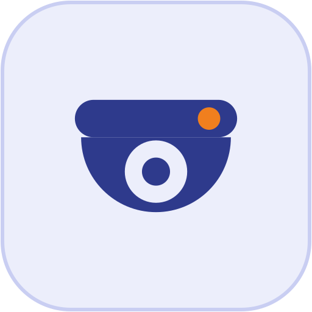

# Софтмонтаж — фирменный стиль (v1.0)

Логотип ТОО «Софтмонтаж»: **ноутбук с бокорезами на экране** («софт» + «монтаж») и надпись **Софтмонтаж / Softmontazh** (с заглавной), шрифт **Rubik Medium**.
Стиль родственный платформе **Esemer** (та же сетка, плашка, толщины линий, шрифт), но свои цвета: **индиго + оранжевый** вместо тёмно-синего + зелёного.

## Цвета
| Токен | HEX | Где |
| --- | --- | --- |
| Индиго (основной) | `#2E3A8C` | логотип, заголовки, тёмные блоки |
| Индиго тёмный | `#232D70` | hover, подвал |
| Оранжевый (акцент) | `#F07F1E` | ручки бокорезов, точки на значках, полосы, метки |
| Оранжевый для кнопок | `#D9650F` | кнопки с белым текстом |
| Оранжевый на тёмном | `#FF9A3D` | акцент на индиго |
| Плашка | `#ECEEFB` / граница `#C9CEF2` | подложка знака и значков, фон секций |
| Текст / второстепенный | `#1F2633` / `#646B8F` | |

Контраст (WCAG): белый на индиго — 10.0:1 (отлично); белый на `#D9650F` — 3.6:1 (хватает для крупного текста: кнопки 18–19 px полужирным и крупнее); белый на `#F07F1E` — 2.7:1, поэтому **текст на `#F07F1E` не пишем**, только значки и полосы. Оранжевым **не набираем текст на белом**.

CSS-переменные — `site/colors.css`.

## Шрифт
**Rubik** (Google Fonts), 400/500/600/700, кириллица + латиница. Логотип — Rubik Medium; в SVG буквы переведены в кривые, шрифт для логотипа не нужен.

## Файлы
```
logo/
  softmontazh-icon.svg / -dark.svg ........ знак на плашке (светлая / индиго)
  softmontazh-icon-512/192.png, -dark-512 .. растровые иконки
  softmontazh-icon-180.png ................ apple-touch-icon (квадрат без прозрачных углов)
  softmontazh-icon-maskable(.svg/-512.png)  иконка с полями для Android (purpose: maskable)
  softmontazh-logo-ru / -en (.svg/.png) ... ОСНОВНОЙ логотип: знак + «Софтмонтаж» / «Softmontazh»
  …-dark .................................. для тёмного фона (белый знак, без плашки)
  …-tight / -tight-dark ................... без полей — для шапки и подвала сайта
  …-sub / -sub-dark ....................... с подписью «СЛАБОТОЧНЫЕ СИСТЕМЫ» / «LOW-VOLTAGE SYSTEMS» (КП, вывески)
  softmontazh-logo-email-ru/en-360.png .... для подписи в письмах
favicon/  favicon.ico (16–64), favicon-16/32.png, softmontazh-favicon.svg
icons/    18 значков разделов × (светлый, -dark) × (SVG, PNG 512) — рисунок как у Esemer, цвета Софтмонтажа
social/   softmontazh-og-1200x630-ru/en (.svg/.png) — превью ссылки в мессенджерах и соцсетях
site/     colors.css, site.webmanifest, head-snippet.html (что вставить в <head> и шапку)
sheets/   обзорные листы (только для просмотра)
```

## Значки разделов
18 значков. Светлый `<slug>.svg` — на светлом фоне, `<slug>-dark.svg` — на индиго. Оптимально 40–64 px в списках.

| slug | Раздел | EN |
| --- | --- | --- |
| `01-svn` | Видеонаблюдение | Video surveillance |
| `02-sks` | СКС / сети связи | Structured cabling |
| `03-ps` | Пожарная сигнализация | Fire alarm |
| `04-skud` | СКУД | Access control |
| `05-os` | Охранная сигнализация | Intrusion alarm |
| `06-gas` | Контроль загазованности | Gas detection |
| `07-domofon` | Домофония | Intercom |
| `08-soue` | СОУЭ (оповещение) | Public address / evacuation |
| `11-ops` | ОПС (охранно-пожарная) | Security & fire panel |
| `12-perimeter` | Охрана периметра | Perimeter security |
| `13-barrier` | Шлагбаумы / парковка | Barriers / parking |
| `14-videodomofon` | Видеодомофония | Video intercom |
| `15-clock` | Часофикация | Clock systems |
| `16-server` | Серверная / стойка | Server room / rack |
| `17-ats` | АТС / телефония | PBX / telephony |
| `18-patch` | Патч-панели (СКС пассив) | Patch panels |
| `19-suppression` | Пожаротушение | Fire suppression |
| `20-electric` | Электромонтаж | Electrical works |

## Правила
- Основной логотип — **без подписи**; с подписью — для КП, документов, вывесок.
- Светлый фон → обычные файлы; тёмный (индиго, фото) → `-dark`.
- Свободное поле вокруг логотипа — не меньше 25% высоты знака. Минимум: знак 24 px, логотип 120 px по ширине.
- Не перекрашивать, не растягивать, не добавлять тени/градиенты/обводки, не набирать надпись другим шрифтом.
- Esemer и Софтмонтаж рядом: разделять вертикальной линией или пробелом, одинаковая высота знаков.

## Подключение на сайте
Положить папку целиком в корень сайта как `brand/` и вставить содержимое `site/head-snippet.html`.
```html


```
